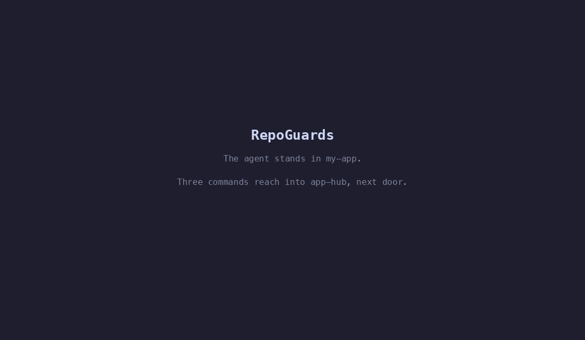

*[English](README.md) · עברית*

# RepoGuards

*לשעבר Grove. השם שונה בגרסה 0.2.0. ראה [שדרוג מ-Grove](#שדרוג-מ-grove).*

**שכבת ההגנה והשליטה לסוכני AI בסביבות מרובות מאגרים (Multi-Repo).**



סוכן AI (כמו Claude Code) הוא כלי עבודה גאוני כשהוא רץ בתוך תיקיית פרויקט (Repository) אחת. אבל בעולם האמיתי, משימות חוצות גבולות: שחרור פיצ'ר דורש שינוי בקוד (App), עדכון סכימת הנתונים (Hub) ועריכת עמוד השיווק (Web). 
ברגע שהסוכן "מושיט יד" לתיקייה זרה, הוא מאבד קשר עם המציאות: בגלל שפקודת `git status` מוגבלת לתיקייה הנוכחית שלו, הוא עלול לדרוס קבצים פתוחים של מפתח אחר, לדחוף קוד לענף הלא נכון, או לבצע קימוט עיוור (Blind Commit) הרסני.

**RepoGuards נבנה כדי לפתור בדיוק את זה.** זוהי מערכת מעקות‑בטיחות שרצה בתוך הסשן, ברגע קריאת הכלי: היא מזהה את החריגה, מסרבת לשתי הפעולות שאין מהן דרך חזרה, ומחזירה לסוכן את תמונת המצב שחסרה לו כדי שיתקן את עצמו.

> **נבנה ל-Claude Code, ונבדק רק שם.** הגארדים הם hooks של Claude Code: הם קוראים את
> פרוטוקול ה-hooks שלו ואת שמות הכלים שלו (`Bash`, `Edit`, `Write`), ו-`close.py` קורא
> את היומן שה-hooks האלה כותבים. הרעיון עובר לכל סוכן שיש לו hook לפני קריאה לכלי; הקוד
> עדיין לא.

---

## המרכיבים: מה RepoGuards עושה?

המערכת מספקת 3 פתרונות קריטיים:

### 1. מעקות בטיחות אקטיביים (The Guard Hooks)
* **חסימת קומיט עיוור (`scope_foreign_commits`):** אם ה-AI עומד בתיקייה A ומנסה להריץ `git commit -a` בתיקייה B, המערכת תחסום אותו. במקום כישלון סתמי, היא תזריק לו את המצב האמיתי של התיקייה הזרה (כולל שם הענף והקבצים הפתוחים שם), ותורה לו לקמט קבצים נקודתית בלבד.
* **כיבוד גבולות (`honor_ownership`):** אם קובץ מסוים הוגדר תחת אחריות של פרויקט אחר (דרך `.claude/owns.json`), ה-Hook יסרב לאפשר ל-AI לערוך אותו, ויפנה אותו למקום הנכון.

### 2. קימוט חכם וחובק-סביבה (`close.py`)
סוכן שמעדכן 3 פרויקטים במקביל משאיר שובל של שינויים. פקודת הגיט הרגילה נשברת כאן. 
הסקריפט `$REPO_GUARDS/tools/close.py --commit` קורא אילו קבצים **הסשן הספציפי הזה** כתב בכל תיקייה, ומעלה ל‑staging רק אותם — לעולם לא סחיפה. מה שהוא תובע לעצמו צר במכוון: נתיב נספר רק אם כלי כתיבה של הסשן הזה נקב בו והוא עדיין מלוכלך, כך שעבודה של סשן מקביל לא תיסחף לקומיט שלך. המחיר של הבחירה הזו כתוב במפורש תחת *גבולות ידועים*.

### 3. הרישום המרכזי (`registry.json`)
המוח שמנהל אילו פרויקטים קיימים במחשב שלך, ואיזה "מסלולי סקילים" (Tracks) כל פרויקט רשאי לטעון. זה מה שמונע מסוכן באפליקציית iOS לטעון פקודות של Android. (המערכת יודעת לעבוד בסנכרון מלא מול ספריות סקילים אחרות, כמו ה-[App Factory](https://github.com/yybd/app-factory)).

---

## התקנה

מכיוון ש-RepoGuards מנהל את הסביבה שלך, הוא בדרך כלל **המוצר הראשון שאתה מתקין**, והוא יושב לצד הפרויקטים האחרים (לרוב תחת התיקייה `<base>` כמו `~/Developer`).

```bash
cd <base>
git clone https://github.com/yybd/repo-guards.git
claude plugin marketplace add "$PWD/repo-guards"
python3 repo-guards/tools/deploy.py
```

**תן ל-`marketplace add` נתיב מלא**, ובשביל זה יש `"$PWD/…"`. ‏`repo-guards` או `dev/repo-guards` לבדם נקראים כ-`owner/repo` ב-GitHub, נכשלים בשגיאת "access rights", וכל צעד אחריהם נכשל בעקבותיהם.

‏`deploy.py` הוא כל ההתקנה: הוא יוצר את `tools/registry.json` שלך מהתבנית שנשלחת עם ה‑repo, מתקין את הפלאגין, ומוודא. הוא מדפיס מה הוא עשה — קרא את זה במקום להניח. **ואז פתח סשן חדש**, כי הוקים וסקילים נקראים בפתיחת הסשן.

**אופציונלי, וכל פריסה תדווח עליו עד שתעשה אותו או תחליט שלא** — כללי העבודה, שנטענים בכל סשן בכל repo:

```bash
ln -s "<base>/repo-guards/rules/global-CLAUDE.md" ~/.claude/CLAUDE.md
```

אם כבר יש לך `~/.claude/CLAUDE.md`, או שאתה רוצה להוסיף על הכללים האלה כללים משלך (למשל באיזו שפה עונים לך), אל תחליף אותו. השאר אותו, והוסף לו שורה אחת שמייבאת את הכללים:

```
@<base>/repo-guards/rules/global-CLAUDE.md
```

הכללים המשותפים נשארים משותפים, התוספות שלך נשארות שלך, ו-deploy מקבל את שתי הצורות. שום דבר אחר לא תלוי בצעד הזה.

### חיבור פרויקט חדש למערכת
כדי שהמעקות והסקילים יפעלו בפרויקט מסוים (למשל פרויקט צד-לקוח שלך), כנס אליו והפעל:
```bash
/repo-guards:register-project
```
הפקודה הזו קוראת את הפרויקט, כותבת את הרשומה שלו ב‑`registry.json` של RepoGuards, ויוצרת `.claude/settings.json` מקומי בפרויקט עצמו.

**מה הרישום משנה ומה לא.** המעקות תמיד פועלים — הם נשלחים עם הפלאגין, שמופעל ברמת המשתמש, ולכן הם רצים בכל repo בין שהוא רשום ובין שלא. הרישום מכריע שני דברים אחרים: **אילו מסלולי סקילים נטענים שם**, והאם המעקה של סוף התור **ידווח על עבודה שהשארת שם ללא קומיט**. כלומר repo לא רשום אינו מוגן בכך שמתעלמים ממנו; הוא repo שטוען בשקט אפס מסלולים.

לכן repo לא רשום אומר זאת, פעם אחת בכל סשן. **הוא שואל שלוש פעמים ואז מפסיק להפריע** — מכאן ואילך זו שורה אחת, שעדיין נאמרת בכל סשן, כי מה שהיא מדווחת אינו נעלם מעצמו. שתי תשובות מסיימות את זה: לרשום את ה‑repo, או לרשום אותו תחת `ignored`. במכונה מלאה ב‑repos שאינם עניינך, ‏`REPO_GUARDS_OFFER=off` בסביבה, או `"offer_registration": false` ברישום, מסיים את זה בכל מקום.

---

## כללי ברזל לעבודה עם סוכנים (Cross-Repo)

בזמן שאתה עובד על פרויקט במקביל לפרויקטים אחרים, אלו הכללים ש-RepoGuards אוכף:
1. **קראו את המודיעין המוזרק:** ברגע שתגעו בתיקייה זרה, המערכת תזריק לסוכן הודעת `[foreign]` הכוללת את הסטטוס המרוחק (כולל שם ה-Branch). הסוכן אמור לקרוא את זה לפני שהוא ממשיך לערוך.
2. **אסור לבצע `push` מרחוק:** פקודה כמו `git -C ../other-repo push` חסומה לחלוטין. Push דוחף ענף שלם, פעולה אלימה מדי כשמבצעים אותה "מעבר לקיר".
3. **אל תאספו זבל:** לעולם אל תעשו `add .` על תיקייה זרה. עבדו נקודתית עם נתיבים מדויקים, או שתנו ל-`close.py` לעשות את העבודה הקשה בשבילכם.
4. **דוח סיום תור:** בסוף כל הודעה שבה הסוכן השאיר קבצים זרים פתוחים מבלי לקמט אותם, סוכן ה-Stop Guard של RepoGuards יציף לך אזהרה למסך: "השארת בלאגן במקום אחר".

---

## שדרוג מ-Grove

עד גרסה 0.1.0 המוצר נקרא Grove. ה-marketplace, הפלאגין והפקודות קיבלו שם חדש, ולכן `grove@grove` מותקן לא מתעדכן במקום, אלא מוחלף:

```bash
git -C <התיקייה שלך> pull
claude plugin marketplace remove grove
claude plugin marketplace add "<התיקייה שלך, נתיב מלא>"
python3 <התיקייה שלך>/tools/deploy.py
claude plugin uninstall grove@grove      # רק אחרי ש-deploy מדווח ש-repo-guards מותקן
```

‏`/grove:deploy` הוא עכשיו `/repo-guards:deploy`, ו-`$GROVE` הוא עכשיו `$REPO_GUARDS`. במשך גרסה אחת השמות הישנים ממשיכים לעבוד: deploy עדיין כותב את `$GROVE`, כל משתני `GROVE_*` עדיין נקראים, ואפשר עדיין לייבא את `grove_repo`. הכתובת הישנה ב-GitHub מפנה לחדשה. שם התיקייה המקומית שלך לא משנה.

---

## גבולות ידועים

מעקה שמתחזה לכיסוי מלא גרוע ממעקה שגבולו ידוע. אלה הגבולות, והם נבדקים:

* **מה שסקריפט כותב מבפנים אינו בהישג יד.** ‏`python3 build.py` יכול לכתוב לכל מקום, ושום דבר בשורת הפקודה לא מעיד על כך. המעקות קוראים קריאות כלים ושורות shell; הם אינם צופה מערכת קבצים.
* **פקודה שהיעד שלה מחושב אינה ניתנת לשיפוט.** ‏`git -C $DIR push` או נתיב שנבנה ב‑`$(…)` מתפענחים בזמן ריצה, בתוך ה‑shell — כך שהמעקה רואה משתנה, ובמכוון מאשר. כל מה שהוא אינו יודע לפענח בוודאות, הוא מאשר.
* **הוא נכשל‑פתוח, תמיד.** מטען פגום, רישום לא קריא, קובץ חסר — כל אחד מהם מאשר את הפעולה. מעקה שחוסם בטעות עוצר עבודה; מעקה שקורס עוצר הכול.
* **‏`close.py` תובע פחות מדי ולא יותר מדי.** קובץ שנכתב דרך שורת shell מדווח כשונה אך לעולם לא מועלה ל‑staging עבורך, והדוח אומר זאת.

---

## איך זה עובד מבפנים?

רצית לדעת איך ה-Hooks קוראים פקודות או איך עובד מטמון הפלאגינים? 
קרא את התיעוד המלא:
* **[איך זה עובד (HOW-IT-WORKS.md)](HOW-IT-WORKS.he.md)** — הצצה מתחת למכסה המנוע: המטמון (Cache), הוקים וטעינת הרישומים.
* **[CLAUDE.he.md](CLAUDE.he.md)** — החוקה וההנחיות שהסוכן קורא כשהוא נמצא בתוך ה-Repo הזה עצמו (כדי לפתח את RepoGuards).
* **[תיקיית התיעוד והנימוקים (docs/)](docs/)** — כל החלטה ארכיטקטונית (מה נמדד, למה פסלנו פתרונות אחרים) נמצאת שם.

---

**רישיון:** MIT
